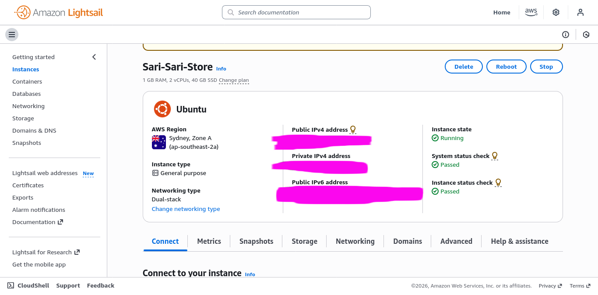

# SARI-SARI-SHOP-API
- backend api for [sari-sari-shop](https://github.com/i-am-Khael/sari-sari-shop)
- preparing the api first before integrating it to sari-sari-shop and dashboard frontend.
- this is just a hobby project

### TECH USED ( currently )
- Linux ( Debian 13 ) Operating System
- Homebrew/Linuxbrew ( for installing nginx, php and mysql ) during development
- NGINX Web Server
- PHP 8.4
- MySQL 8.4
- [ZED ( for my text editor )](https://zed.dev)
- [Bruno for API Debugging and Testing](https://usebruno.com)
- [Paypal SDK - for payment demo](https://developer.paypal.com/)
- [AWS LighSail](aws.amazon.com/lightsail/)
- [Hostinger for sari-sari-shop.store domain (valid for 1 year)](https://hostinger.com)

#### AWS Instance Image

